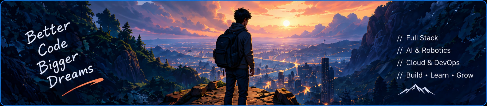
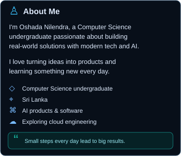
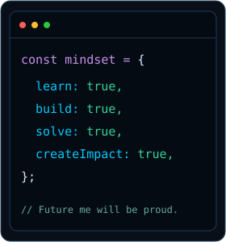
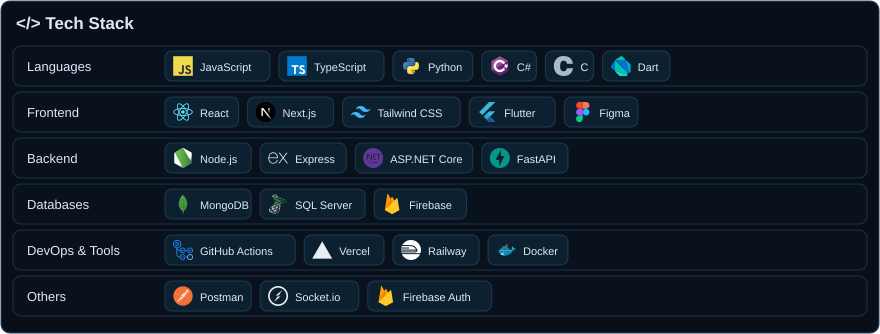
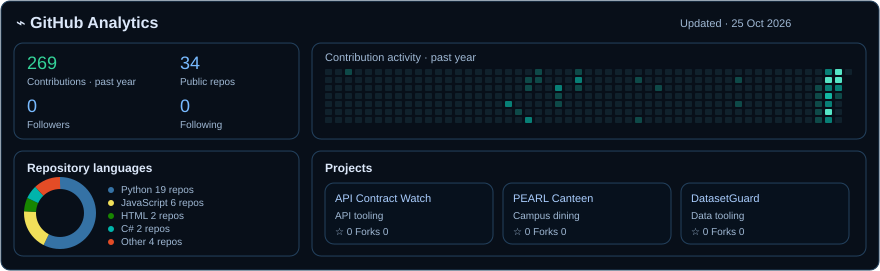
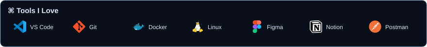

<!-- Profile README for Oshada Nilendra. Self-contained SVG cards use GitHub-compatible image markup. -->

  
  
  

### 🔗 Connect With Me

<!-- Add LinkedIn, email, and portfolio buttons only when actual URLs are available. -->

Updates daily · <a href="./ANALYTICS.md">Refresh details</a>

### 📌 Featured Repositories

| [API Contract Watch](https://github.com/oshada28nilendra-debug/api-contract-watch) | [PEARL Canteen](https://github.com/oshada28nilendra-debug/smartcanteen-pearl) | [DatasetGuard](https://github.com/oshada28nilendra-debug/datasetguard) |
| :--- | :--- | :--- |
| API contract tooling | Campus dining application | Dataset tooling |

⚡ Currently learning

AI & Robotics · System Design · Cloud & DevOps · Full Stack · Data Engineering · Cyber Security

<i>“The best way to predict the future is to build it.”</i> Build · Learn · Grow

